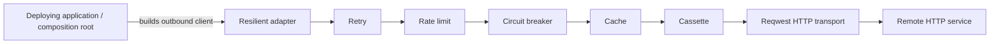

# Architecture

This workspace provides outbound HTTP client code and reusable client-side resilience middleware.
The deploying application or runtime remains responsible for server machinery.

## Transport and server boundary

The transport package **MUST ship real outbound HTTP transport code**: wire-level request and
response handling, a working HTTP client, streaming support, and middleware integration. It **MUST
NOT** bind server listeners, run accept loops, terminate inbound TLS, or own a server connection's
lifecycle. Those responsibilities belong to the deploying application or runtime.

This is a client transport boundary, not a prohibition on real networking code. The `transport`
crate uses reqwest to send requests and exposes outbound HTTP and streaming contracts. Applications
assemble policy and middleware around that primitive.

## Package responsibilities

| Package | Responsibility |
| --- | --- |
| `transport` | Outbound HTTP contracts, reqwest-backed transport, and streaming support |
| `retry` | Retry middleware and policy |
| `rate` | Per-host rate limiting |
| `breaker` | Per-host circuit breaking |
| `cache` | HTTP response caching |
| `cassette` | Deterministic recording and replay |
| `resilient-port` | Contract for composing resilience middleware |
| `resilient` | Config-driven or default composition of retry, rate, breaker, cache, and cassette |

Authentication, OAuth, TLS policy, and load balancing are composition-root concerns. The transport
exposes `SecurityContext` for identity propagation; it does not implement those policies. The
resilience adapter returns a composable middleware client builder so applications can add their
own layers at the required position.

## Outbound request flow

The composition root creates the bare transport and chooses how to assemble client policy. When it
uses `resilient`, the resilience concerns are registered in their required relative order:

The config-driven adapter registers a layer only when its configuration section enables it. The
default adapter applies the shipped retry, rate, breaker, cache, and cassette behavior. Applications
that do not need this adapter can use the transport directly or build their own middleware chain.

## Related decisions

- [ADR-003: load balancing moves to the composition root](adr/ADR-003-loadbalancer-moves-to-composition-root.md)
- [ADR-005: retry and breaker composition moves out of transport](adr/ADR-005-retry-breaker-composition-moves-out-of-transport.md)
- [ADR-006: resilient middleware ports and adapter](adr/ADR-006-resilient-splits-into-port-adapter-scoped-to-order-coupled-concerns.md)
